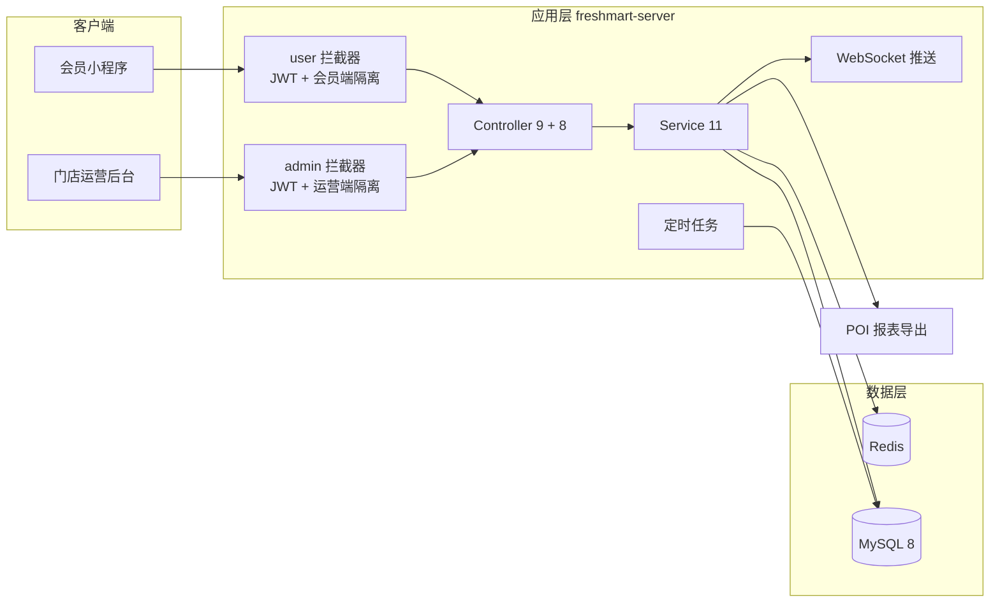
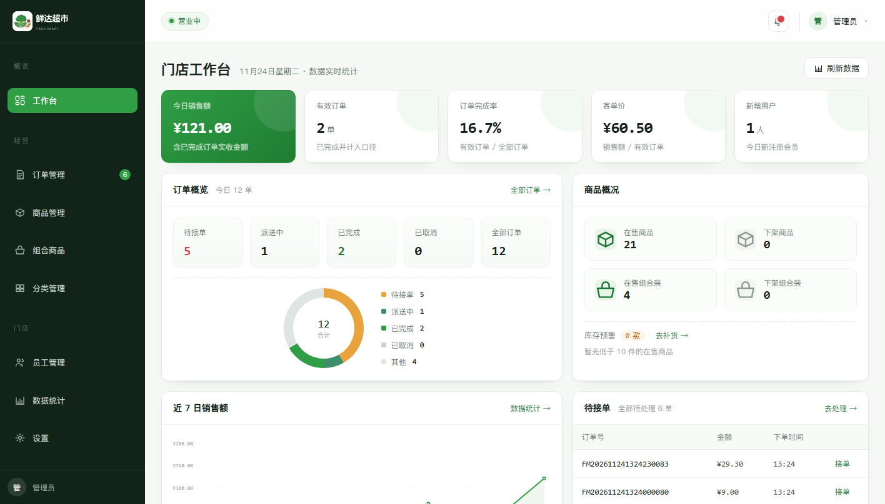

# 鲜达超市 FreshMart

> 一个 **线上生鲜超市** 的后端系统：会员在小程序里逛超市、加购物车、下单付款；
> 门店收到订单后拣货打包、配送上门，**30 分钟送达**。

不用猜是什么项目——它就是「网上超市卖菜卖日用品，下单后半小时送到家」。

---

## 1. 项目做什么

用户视角：打开小程序 → 按类目逛商品（蔬菜、水果、肉蛋、日用）→ 加购物车 → 下单付款 → 30 分钟内骑手送到。

门店视角：管理商品和类目、设置营业状态、接单、拒单、派送、查看今日销售额和热销榜。

系统就这么三块：

| 角色 | 干什么 |
| --- | --- |
| 会员（小程序） | 逛商品、购物车、地址、下单、支付、取消、催单 |
| 门店（运营后台） | 商品/类目/组合商品维护、订单履约、经营看板、报表导出 |
| 系统 | 库存外的所有状态流转、缓存、实时新单提醒、定时关单、日报生成 |

## 2. 技术栈

| 分层 | 选型 |
| --- | --- |
| 语言 / 构建 | Java 17、Maven 3.9（多模块） |
| 框架 | Spring Boot 2.7.3、Spring MVC、MyBatis-Plus 3.5.3.1 |
| 存储 | MySQL 8.0（Druid 连接池）、Redis 7（商品列表缓存） |
| 实时通信 | WebSocket（新单提醒、用户催单） |
| 鉴权 | JWT（jjwt）+ 拦截器 + ThreadLocal 上下文 |
| 报表 | Apache POI 4.1.2（Excel 模板填充） |
| 文档 | Knife4j 3.0.2（Swagger2，按端分组） |
| 其他 | Lombok、Jackson、全局异常处理、统一响应体 |

## 3. 功能清单

### 3.1 门店运营后台

| 模块 | 能力 |
| --- | --- |
| 员工管理 | 登录、新增、分页查询、启停用、编辑、修改密码 |
| 商品类目 | 商品类目 / 组合商品类目双类型维护、分页、启停用、删除前关联校验 |
| 商品管理 | 新增/修改（含规格）、分页、批量删除、上下架、库存设置、按类目查询 |
| 组合商品 | 新增/修改（含商品明细）、分页、批量删除、上下架、回显 |
| 订单管理 | 条件搜索、接单、拒单、取消、派送、完成（全部为状态条件更新，重复操作会被拒绝） |
| 经营看板 | 今日销售额 / 有效单量 / 完成率 / 客单价 / 新增会员、各状态单量、商品总览 |
| 数据统计 | 销售额趋势、会员增长、订单统计、商品动销 Top10、导出近 30 天销售日报 |
| 文件与门店 | 图片上传（OSS）、门店营业状态设置（Redis） |

### 3.2 会员小程序端

> 配套会员端小程序工程见 `docs/小程序启动.md`（原生小程序，8 个页面，直连本项目 `/user/**` 接口）。


| 模块 | 能力 |
| --- | --- |
| 登录 | 微信授权登录（openid 换 JWT）；本地开发可用 dev-login 跳过微信凭证 |
| 逛商品 | 类目 tab、商品网格（库存/售罄标记）、商品详情（含规格与实时库存），列表走 Redis 缓存 |
| 购物车 | 加购、减购、清空、金额合计 |
| 地址簿 | 增删改查、默认地址、结算页选择地址 |
| 下单 | 提交订单、模拟支付、订单列表（状态筛选）、订单详情、取消、再来一单、催单 |
| 门店状态 | 查询门店是否营业 |

> 共 **71 个 REST 接口**，在线文档：`http://localhost:8080/doc.html`

## 4. 系统架构



### 代码结构

```
freshmart                    聚合工程（依赖与版本统一管理）
├── freshmart-common         通用能力：Result/PageResult、JWT、OSS、异常、常量、ThreadLocal 上下文
├── freshmart-domain         领域模型：entity / dto / vo
├── freshmart-server         应用服务：controller / service / mapper / config / interceptor / task / websocket
├── frontend/admin           门店运营后台（原生 ES Module，无构建）
├── frontend/miniprogram     会员端小程序（原生小程序）
├── sql                      建表、货盘与演示数据脚本
└── scripts                  一键启动脚本
```

- `common` 不依赖任何模块，`domain` 只依赖 `common`，`server` 依赖两者；
- entity 与表一一对应（`@TableName`），DTO 承接入参，VO 承担出参裁剪；
- 统一返回体 `Result<T>`，业务异常继承 `BaseException`，由 `GlobalExceptionHandler` 收敛成 code + msg。

### 数据表（12 张）

| 表 | 说明 |
| --- | --- |
| `category` | 类目（1 商品类目 / 2 组合商品类目） |
| `product` | 商品（价格、图片、上下架状态） |
| `product_spec` | 商品规格（温度 / 甜度 / 份量等） |
| `bundle` | 组合商品（凑单装、场景包） |
| `bundle_item` | 组合商品与商品的关联明细 |
| `cart` | 会员购物车 |
| `trade_order` | 订单主表（状态机、支付状态、配送信息、下单幂等令牌） |
| `trade_order_item` | 订单商品明细 |
| `stock_log` | 库存流水（扣减/回滚，唯一键保证回滚幂等） |
| `address_book` | 会员收货地址 |
| `user` | 会员（openid 维度） |
| `employee` | 门店员工 |

## 5. 关键设计

### 5.1 订单状态机 + 并发控制

```
1 待支付 ──支付成功──▶ 2 待拣货 ──接单──▶ 3 已接单 ──派送──▶ 4 配送中 ──完成──▶ 5 已完成
   │                      │                 │                    │
   └──超时/用户取消──▶ 6 已取消 ◀──拒单──────┘                    └──异常/超时──▶ 6 已取消
```

- **所有跃迁都是条件更新**：`update trade_order set status = ? where id = ? and status = ?`，
  影响行数为 0 说明状态已被别人改过，直接抛「订单状态已变更，请刷新后重试」。
  两个店员同时点「接单」只会有一个成功，另一个人收到明确提示，而不是两个人都"成功"；
- 状态机与写操作在 Service 层收敛，非法跃迁统一抛 `OrderBusinessException`；
- 下单在 `@Transactional` 里完成「写订单 + 批量写明细 + 扣库存 + 清空购物车」，四张表原子；
- 定时任务只负责扫候选单，关单/完结逻辑下沉到 Service 的事务方法里，
  所以「改状态 + 回滚库存」一定在同一个事务中。

### 5.2 库存中心

**DB 是库存唯一事实源**，Redis 只做读缓存和下单前快检——这一点是刻意的取舍：

| 层 | 作用 | 为什么不让 Redis 扣库存 |
| --- | --- | --- |
| `product.stock` | 真正的可售库存 | — |
| `ProductMapper.deductStock` | `update ... set stock = stock - ? where id = ? and stock >= ?`，影响行数 0 即库存不足 | 条件更新本身就不会超卖，且与订单在同一事务里，不需要补偿 |
| Redis `freshmart:stock:{id}` | 商品列表/详情展示、下单前快检 | 缓存会飘，扣减交给它就要处理「Redis 扣了 DB 失败」「Redis 挂了」两类一致性问题 |
| Lua 脚本 | 「读-比较」原子化，明显不足的请求在开事务前就被拒绝 | 只做快检，不写库存，失败可回源 DB 复核，不会误拒 |

下单链路：**幂等令牌校验 → 汇总商品数量（组合商品按组成拆解）→ Redis+Lua 快检 → 事务内条件扣减 + 写流水 → 清购物车 → 刷新缓存**。

回滚：取消 / 拒单 / 超时关单都会回滚库存，靠 `stock_log` 的唯一键
`(order_id, product_id, type)` 保证幂等——`insert ignore` 返回 0 就说明这笔已经回滚过了，
**用户取消和定时任务同时关单也只会回滚一次**。

### 5.3 下单幂等

- 客户端每次「进入结算页」生成一个 `idempotentToken`，提交时带上；
- 服务端先按令牌查订单，命中直接返回**同一笔订单**（网络重试、重复点击都不会多下单）；
- 数据库对 `trade_order.idempotent_token` 建唯一索引兜底并发：两个请求同时进来，只有一个能插入成功；
- 支付接口也做了幂等：已支付的订单重复调用直接返回，不会重复推送新单。

### 5.4 缓存

- 商品列表是典型的高频读数据，按**类目维度**缓存：`freshmart:product:category:{categoryId}`；
- 商品/类目发生写操作（新增、修改、删除、上下架）后按前缀 `freshmart:product:*` 批量失效；
- **库存不放进商品列表缓存**：库存随每笔订单变化，放进去立刻变脏；返回前再用 `StockService.getStock` 补实时库存；
- 组合商品列表用 Spring Cache 注解（`bundleCache`），写操作 `@CacheEvict` 清理。

> 已知取舍：`keys` 前缀删除在 key 量大时会阻塞 Redis，生产环境应改成精确删除或 `SCAN`（见第 7 节）。

### 5.5 实时提醒

支付成功后服务端通过 WebSocket 向门店后台广播「新单提醒」；会员点「催单」时广播催单消息。
门店不用轮询数据库就能知道有新单要拣。

### 5.6 登录与上下文

- `/admin/**` 与 `/user/**` 各一个 JWT 拦截器，登录接口白名单放行；
- 解析出的操作人 id 放进 `BaseContext`（ThreadLocal），Service 层直接取，不用层层传参；
- MyBatis-Plus 元对象处理器自动填充 `create_time / update_time / create_user / update_user`。

### 5.7 报表

- 聚合查询产出销售额趋势、会员增长、订单完成率、动销 Top10（口径是 `status = 5` 的已完成单）；
- 销售日报用 POI 读 `template/fulfillment-daily-report.xlsx` 模板，填充近 30 天概览与明细后流式输出，不用手写单元格样式。

## 6. 快速开始

### 6.1 环境

- JDK 17、Maven 3.9+、MySQL 8.0+、Redis 7+（缓存与门店状态需要，其余可跑）

### 6.2 建库

```bash
# 1) 建库建表（12 张表，含库存流水）
mysql -uroot -p < sql/freshmart.sql
# 2) 导入生鲜示范货盘（7 个类目 / 21 个商品 / 1 个组合装 / 3 笔演示订单）
mysql -uroot -p < sql/seed_catalog.sql
# 3) 可选：把演示数据换成更完整的一套（4 个组合装 / 37 笔订单 / 14 个会员 / 8 名员工）
mysql -uroot -p freshmart < sql/seed_demo.sql
```

`seed_catalog.sql` 会清空商品、类目、购物车、订单、库存流水后重新写入，可反复执行。
`seed_demo.sql` 在此基础上再补会员、员工和 37 笔覆盖全部状态的历史订单（时间摊在近 30 天），跑完工作台和统计页就有曲线可看。
商品图已换成实拍照片，上传到阿里云 OSS，`product.image` 存 OSS 直链；`static/goods` 保留同名 jpg 作离线兜底。

> 如果你是从旧版本升级（库里还没有 `stock`、`idempotent_token`、`stock_log`），先执行
> `mysql -uroot -p < sql/migrate_stock_and_idempotent.sql`，再跑货盘脚本。

### 6.3 配置

默认读 `application-dev.yml`，敏感项都走环境变量：

| 变量 | 说明 | 默认 |
| --- | --- | --- |
| `FRESHMART_DB_HOST` / `FRESHMART_DB_PORT` | MySQL 地址 | localhost / 3306 |
| `FRESHMART_DB_NAME` | 库名 | freshmart |
| `FRESHMART_DB_USERNAME` / `FRESHMART_DB_PASSWORD` | 账号密码 | root / ******（必须自己设） |
| `FRESHMART_JWT_ADMIN_SECRET` / `FRESHMART_JWT_USER_SECRET` | 两端 Token 签名密钥 | ******（生产环境务必换成长随机串） |
| `FRESHMART_REDIS_HOST` / `FRESHMART_REDIS_PORT` | Redis 地址 | localhost / 6379 |
| `FRESHMART_OSS_*` | 阿里云 OSS（图片上传） | 空，需自备 |
| `FRESHMART_WX_APPID` / `FRESHMART_WX_SECRET` | 微信小程序（会员登录） | 空，需自备 |

> 没配 OSS / 微信凭证时，图片上传和微信登录不可用，其他功能不受影响。

### 6.4 启动

```bash
mvn clean package
java -jar freshmart-server/target/freshmart-server-1.0-SNAPSHOT.jar
```

- 端口：`8080`
- 接口文档：<http://localhost:8080/doc.html>（「门店运营端」/「会员端（小程序）」两个分组）
- 门店默认账号：`admin / 123456`
- 支付是**模拟实现**（没接真实微信支付），支付成功后订单直接进入「待拣货」并发新单提醒
- 会员端小程序：仓库里在 `frontend/miniprogram`，本地用微信开发者工具导入该目录，详见 [`docs/小程序启动.md`](docs/小程序启动.md)
- 门店运营后台：<http://localhost>（nginx 80），详见 [`docs/管理端说明.md`](docs/管理端说明.md)
- 演示数据：21 商品 / 4 组合装 / 37 订单 / 14 会员，怎么造的在 [`docs/演示数据.md`](docs/演示数据.md)

### 6.5 门店运营后台

后台是**自研的零依赖前端**：原生 ES Module + hash 路由 + 手写 SVG 图表，没有 npm、没有构建步骤，
源码在仓库 `frontend/admin`，本地把它拷到 nginx 的 `html/admin` 下即可（改完刷新就生效）。

```powershell
cd <nginx 目录>
Start-Process .\nginx.exe -WorkingDirectory '<nginx 目录>'
# 打开 http://localhost ，账号 admin / 123456
```

8 个页面：工作台（KPI + 订单环形图 + 库存预警 + 销售趋势 + 待接单）、订单（状态 tab / 筛选 / 接单派送完成取消 / 详情抽屉）、
商品（规格编辑、上下架、库存告警）、组合商品（明细行编辑）、分类、员工、数据统计（趋势图 + Top10 + 导出）、设置（营业开关 / 改密码）。

nginx 把 `/api/` 反代到 `http://localhost:8080/admin/`，`/static/` 指向 `html/sky/static` 继续供商品图片兜底。
设计说明、接口对照、已知限制和踩过的坑都在 [`docs/管理端说明.md`](docs/管理端说明.md)。



### 6.6 接口测试

73 个接口（管理端 48 / 会员端 25）有全量冒烟脚本，覆盖增删改查、订单状态机、库存扣减回滚、
下单幂等、上传与报表导出，以及未授权、重复提交、库存不足、非法状态流转等异常路径，共 135 条用例：

```bash
python tools/api_test.py
```

脚本自带造数与清理，最后打印通过率。本轮测试发现并修复了 3 个缺陷（支付与默认地址两处路由少斜杠、
下单时空值拷贝异常），详情见 [`docs/接口测试报告.md`](docs/接口测试报告.md)。

## 7. 还能怎么升级

下列是按当前实现评估的下一步，**都还没做**：

1. **超时闭环**：用延迟消息（RabbitMQ 死信 / RocketMQ 延迟级别）替代每分钟轮询扫描，关单和回滚库存作为消费逻辑；
2. **WebSocket 集群化**：会话集中到 Redis，多实例广播；
3. **缓存治理**：`SCAN` 替代 `keys`，热点类目加本地缓存与空值缓存防穿透；
4. **库存对账**：定时任务比对 `product.stock` 与 `stock_log` 汇总，发现不一致告警；
5. **报表预聚合**：按天离线汇总到统计表，避免实时聚合大表。

## 8. 说明

- 个人项目，业务与工程实现按「线上生鲜超市 + 30 分钟达」场景落地；
- 会员端小程序与门店运营后台均为本人开发（后台为零依赖原生 JS 单页应用，源码在 `frontend/admin`）；
- 微信支付、短信、真实运力调度等外部依赖用模拟实现替代，代码里有标注；
- `sql/freshmart.sql` 里的数据仅用于功能演示。
