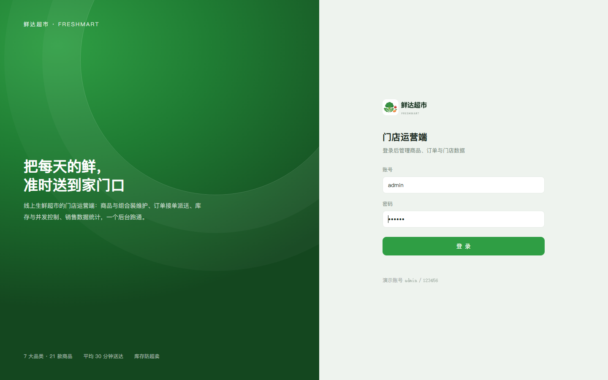
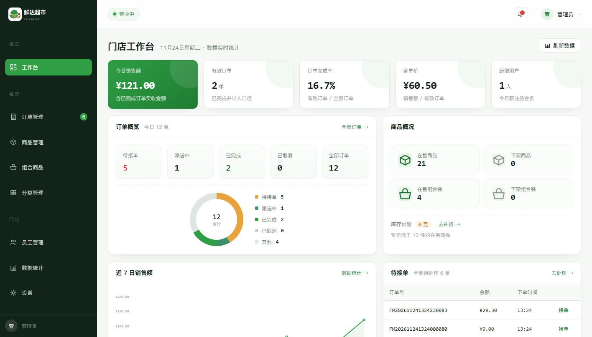
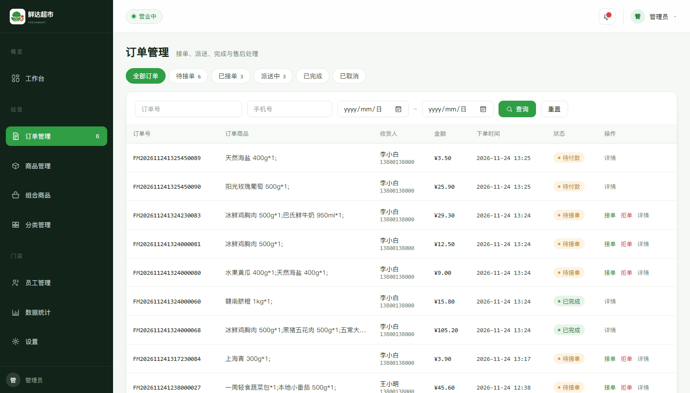
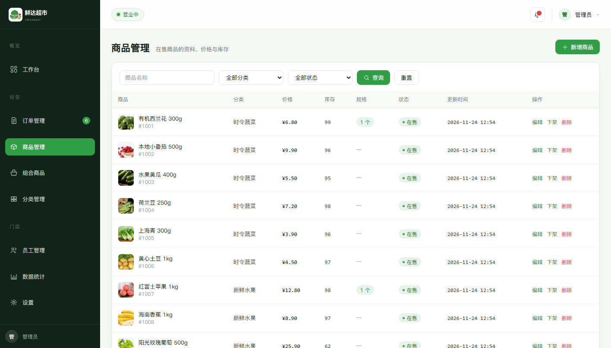
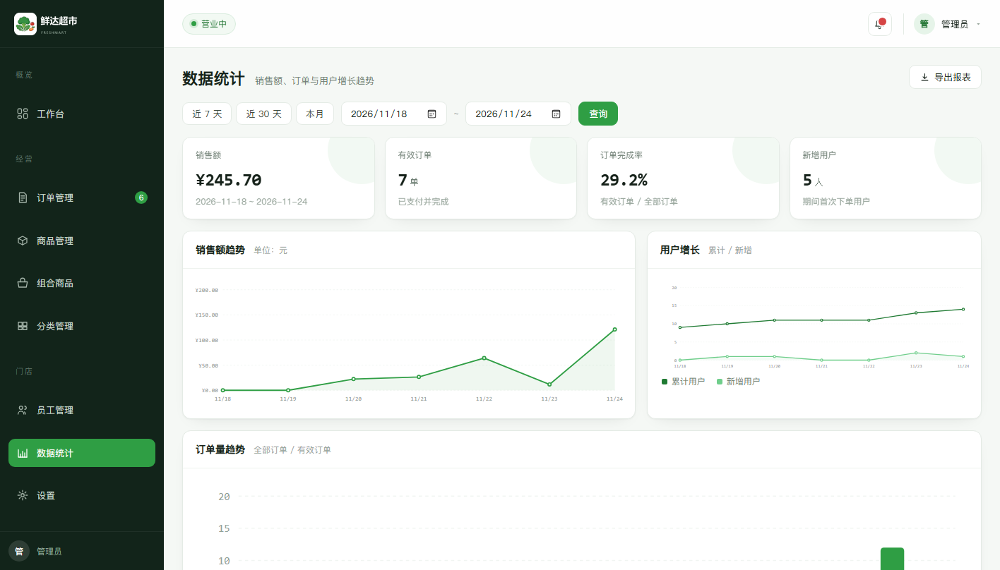

# 门店运营后台 · 启动与说明

自研管理端，位于 `frontend/admin`：**零依赖原生 ES Module + hash 路由 + 手写 SVG 图表**，
没有 npm、没有构建步骤，改完代码刷新浏览器就生效。

## 1. 访问地址

**http://localhost**（nginx 80 端口）

- 账号：`admin / 123456`
- 页面标题：鲜达超市 · 门店运营端
- 演示账号已预填在登录框里，点「登录」即可

## 2. 启动顺序

```powershell
# 1. MySQL（一般开机自启）
Get-Service MySQL80

# 2. Redis
Start-Process '<Redis 目录>\redis-server.exe' -WorkingDirectory '<Redis 目录>'

# 3. 后端（8080）
cd <项目根目录>
java -jar freshmart-server\target\freshmart-server-1.0-SNAPSHOT.jar

# 4. nginx（80）
cd <nginx 目录>
Start-Process .\nginx.exe -WorkingDirectory '<nginx 目录>'
```

改过 `nginx.conf` 一定要先 `.\nginx.exe -t` 再 `-s reload`；停服务用 `.\nginx.exe -s stop`。

## 3. 请求链路

```
浏览器 http://localhost
   ├─ /                → html/admin 的 SPA（try_files 兜底 index.html）
   ├─ /assets/**       → 前端源码（app.css / app.js / core.js / charts.js / views/*.js）
   ├─ /api/xxx         → http://localhost:8080/admin/xxx   ← 管理端接口
   ├─ /user/xxx        → http://localhost:8080/user/xxx    ← 会员端接口
   ├─ /ws/xxx          → WebSocket（新单提醒）
   └─ /static/**       → 商品插画，alias 到 html/sky/static
```

登录后 JWT 存在 `localStorage` 的 `fm.token`，请求头字段 `token`，后端 `/admin/**` 拦截器校验；
接口返回 401 时前端会自动清 token 并跳回登录页。

## 4. 目录结构

```
html/admin
├─ index.html                 入口，挂载 #app
├─ img/                       品牌图：logo-on-dark / logo-lockup / mark-badge / favicon / placeholder
└─ assets
   ├─ app.css                 设计系统（变量、卡片、表格、抽屉、弹窗、toast、响应式）
   ├─ core.js                 store / api / 格式化 / 对话框 / 图标 / 表格分页
   ├─ charts.js               折线、柱状、横向条形、环形（纯 SVG，无第三方库）
   ├─ app.js                  登录页、侧栏外壳、hash 路由、门店状态、未读数轮询
   └─ views
      ├─ workbench.js         工作台：KPI、订单概览环形图、商品概况 + 库存预警、近 7 日销售额、待接单
      ├─ orders.js            订单：状态 tab、条件筛选、接单/拒单/派送/完成/取消、详情抽屉
      ├─ products.js          商品：筛选、规格行编辑、上下架、删除、库存告警
      ├─ bundles.js           组合商品：明细行编辑，选单品自动带出名称与单价
      ├─ categories.js        分类：商品类目 / 组合类目两套 tab
      ├─ employees.js         员工：搜索、编辑、启停、新增（初始密码 123456）
      ├─ stats.js             统计：日期区间、4 项指标、三张趋势图、Top10 动销、导出报表
      └─ settings.js          设置：门店营业开关、账号信息、修改密码
```

路由是 hash 形式：`#/workbench`、`#/orders`、`#/products`、`#/bundles`、`#/categories`、
`#/employees`、`#/stats`、`#/settings`。

## 5. 与后端接口的对应关系

| 页面 / 操作 | 接口 |
| --- | --- |
| 登录 / 退出 | `POST /api/employee/login`、`/logout` |
| 工作台指标 | `GET /workspace/businessData`、`/overviewTradeOrder`、`/overviewProductes`、`/overviewBundles` |
| 近 7 日销售额 | `GET /report/gmvStatistics?begin=&end=` |
| 订单列表 | `GET /order/conditionSearch`（number / phone / status / beginTime / endTime） |
| 订单状态流转 | `PUT /order/confirm`、`/rejection`、`/delivery/{id}`、`/complete/{id}`、`/cancel` |
| 订单详情 | `GET /order/details/{id}` |
| 待办红点 | `GET /messages/countUnread`（语义 = 待接单订单数） |
| 商品增删改查 | `GET/POST/PUT/DELETE /product`、`/product/page`、`/product/{id}`、`POST /product/status/{status}` |
| 组合商品 | `GET/POST/PUT/DELETE /bundle`、`/bundle/page`、`/bundle/{id}`、`POST /bundle/status/{status}` |
| 分类 | `GET/POST/PUT/DELETE /category`、`/category/page`、`POST /category/status/{status}` |
| 员工 | `GET /employee/page`、`POST/PUT /employee`、`POST /employee/status/{status}`、`PUT /employee/editPassword` |
| 门店营业状态 | `GET /store/status`、`PUT /store/{status}` |
| 报表 | `GET /report/{gmvStatistics,tradeOrderStatistics,userStatistics,top10,export}` |

> 报表接口返回的是逗号分隔字符串（`dateList` / `gmvList` / `orderCountList` …），前端 split 后交给图表。

## 6. 为配合这个前端补的后端改动

| 补的东西 | 原因 |
| --- | --- |
| `PUT /admin/employee/editPassword` | 设置页的「修改密码」，原来后端没有 |
| `GET /admin/messages/countUnread` | 顶栏红点，语义实现为「待接单订单数」 |
| 商品分页装配 `specs` | 列表页要显示规格数量，避免逐行回查 |
| 组合商品分页装配 `items` | 列表页要显示「包含单品」，同样做批量装配 |
| 商品/组合表单的图片上传 | 选图后调 `POST /admin/common/upload` 传到 OSS，回填直链并实时预览 |

两处分页装配都是「一次 `in` 查询 + 按父 id 分组」，不改变单条查询的 N+1 形态。

## 7. 设计说明

- **配色**：主色 `#2f9e44`，侧栏墨绿 `#152a1e`，卡片底 `#f7faf7`，边框 `#e8efe9`；
  状态色：在售/已完成绿、待接单橙 `#e8a33d`、已取消灰 `#c9d3cc`。
- **字体**：正文用系统字体，数字用等宽字体（`--mono`），金额、单号、时间戳对齐不跳动。
- **组件**：全部手写 —— 抽屉、弹窗、toast、分页器、状态 pill、骨架屏、空状态，无 UI 框架依赖。
- **图表**：`charts.js` 用 SVG 手绘，`niceScale` 采用 1/2/5 阶梯保证刻度是整数或整齐小数，
  环形图对「单段占满整圈」做了退化处理（用 circle 代替 path）。
- **响应式**：1280 以下收窄侧栏，1080 以下侧栏改为抽屉，720 以下表格横向滚动。

### 图片上传

- 商品/组合表单里的「选择图片」→ `POST /api/common/upload`（nginx 反代到 `/admin/common/upload`）→ `AliOssUtil` 写入 OSS → 返回直链回填输入框，右侧实时预览。
- 配置全走环境变量：`FRESHMART_OSS_ACCESS_KEY_ID`、`FRESHMART_OSS_ACCESS_KEY_SECRET`、`FRESHMART_OSS_BUCKET`、`FRESHMART_OSS_ENDPOINT`（默认 `oss-cn-beijing.aliyuncs.com`），`application-dev.yml` 里只有占位，不落库。
- bucket 需要开「公共读」：`AliOssUtil` 返回的是拼接的直链、不是签名 URL，私有 bucket 打开会 403。
- 不配 AK 也不影响商品展示：`/static/goods/*.jpg` 由 nginx 直接出图，上传只是运营端的附加能力。

## 8. 已知限制

1. 商品表单的库存是直接改 `product.stock`，不走库存流水；生产上应该走入库单；
2. 顶栏「未读」是待接单数量，没有独立消息中心；
3. 支付仍是模拟实现，订单金额都是演示数据；
4. 编辑商品/组合的图片走「选择文件 → 上传 OSS」，也可以直接粘 `/static/goods/*.jpg` 路径；
5. 会员端小程序与管理端是两套前端，登录态不共享。

## 9. 常见坑

| 现象 | 原因 / 处理 |
| --- | --- |
| nginx 报 `unknown directive "锘"` | 配置文件被写成 UTF-8 BOM，用无 BOM 保存 |
| 页面 500 且日志有 `rewrite or internal redirection cycle` | `try_files` 里写了 `\$uri`，应为 `$uri` |
| 改了 JS 没生效 | `Ctrl + F5` 强刷；`/assets/` 有 1 小时缓存头 |
| 库存与管理端显示不一致 | Redis 库存缓存（db **7**），60 秒 TTL；立刻生效：`redis-cli -n 7 del freshmart:stock:<id>` |
| 商品图裂开 | `/static/` 指向 `html/sky/static`，确认文件在 |
| 顶栏红点不消失 | 它是待接单数量，把订单接掉才会变 |

## 10. 截图











## 附：旧的课程 Vue 产物

`frontend/legacy-admin` 还是原来那套 Vue2 + Element UI 产物（已做过接口契约适配、也换过品牌配色），
现在不再对外提供，只作为商品图目录（`/static`）使用。想回退：把 `nginx.conf` 里 `location /` 的
`root html/admin` 改回 `root html/sky`，再 `nginx -s reload`。
